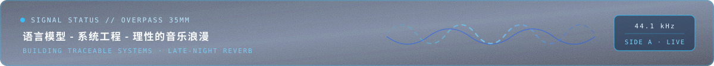

 

 

  ✦ &nbsp;在电车掠过高架桥的失真混响里，把飘忽的灵感调成清澈可寻的信号 &nbsp;✦
   
  <i>Turning drifting noise into traceable signals — somewhere between code, models, and reverb.</i>
   
  <a href="mailto:sternliu@foxmail.com">sternliu@foxmail.com</a>

 

  

 

### `01` &nbsp;TRACKLIST · 正在打磨与开源的项目

<table>
  <tr>
    <td>
      

        <code>01</code> &nbsp;<b><a href="https://github.com/STliuEN/Doki-Assistant">Doki-Assistant</a></b> &nbsp;·&nbsp; <i>Personal AI Agent Runtime & Workbench</i> 
        最初是为了在 VRChat 里方便打字翻译，后来长成了一个全栈 Agent 实验场：把多模型路由、Hybrid RAG（BM25 + Dense + HyDE + Rerank）、记忆中心、MCP 工具和 SSE 流式输出放进同一套可观测运行时。 
        <kbd>FastAPI</kbd> <kbd>React 19</kbd> <kbd>LangChain</kbd> <kbd>ChromaDB</kbd> <kbd>MCP</kbd>
      

      

      

        <code>02</code> &nbsp;<b>Campus Agent</b> <i>(Private)</i> &nbsp;·&nbsp; <i>Multi-Agent Campus Assistant (~10k visits)</i> 
        校内在线运行的 Multi-Agent 助手。在 <b>Go / Temporal</b> 分布式工作流里接入结构化排班查询（PostgreSQL），将工具问答评测集扩充至 0.8 准确率，并持续推进多环境验收与线上 Bad Case 闭环。 
        <kbd>Go</kbd> <kbd>TypeScript</kbd> <kbd>Temporal</kbd> <kbd>PostgreSQL</kbd>
      

      

      

        <code>03</code> &nbsp;<b><a href="https://github.com/STliuEN/ppt-figure-maker">ppt-figure-maker</a></b> &nbsp;·&nbsp; <i>Round-trip Research Figure Agent Skill</i> 
        被改图改到吐血后的产物：AI 生成结构化 Manifest 渲染成<b>可编辑 PPTX</b>，手改后还能读回继续迭代，自带版本快照与文本溢出 / 重叠 / 箭头拓扑的视觉自检。 
        <kbd>Python</kbd> <kbd>Agent Skill</kbd> <kbd>Manifest ⇄ PPTX</kbd>
      

      

      

        <code>04</code> &nbsp;<b><a href="https://github.com/STliuEN/DSAFC">DSAFC</a></b> &nbsp;·&nbsp; <i>Deep Graph Clustering on Imperfect Graphs</i> 
        面向真实图数据中“噪声边 & 缺边”的自适应双结构融合深度图聚类（投稿 <i>Applied Intelligence</i>）。科研代码不花哨但很诚实：哪组超参、哪份日志没对上都藏不住。 
        <kbd>PyTorch</kbd> <kbd>Graph Learning</kbd> <kbd>Clustering</kbd>
      

    </td>
  </tr>
</table>

✦ ────────────── ✦

### `02` &nbsp;LIVE SESSIONS · 私有生产环境下的 Agent 架构实践

<table>
  <tr>
    <td>
      <ul>
        <li><b>大规模数仓 Text-to-SQL</b>：面对 <b>83 表 / 1,886 字段</b>且缺外键关系的 Doris 数仓，设计 <code>Planning → Deterministic Compilation / LLM Gen → Independent Verifier</code> 混合架构；紧凑 Schema 压缩减少 55%–66% 提示体积，未确认关系禁写 JOIN，单轮调用压至 2–3 次、首轮响应压进 1 分钟内。</li>
        <li><b>流式规则异常研判</b>：以“先分类、再比较”两阶段引擎 + 五态语义区分数据脏污与真实异常；做控制面与数据面分离后，工作流从 81 节点收敛至 17 节点，节点输出从 <code>128 MB → 1.1 MB</code>、耗时降 <b>74%</b>。</li>
        <li><b>多模态合规稽核</b>：将 OCR 抽取与稽核报告拆成双服务（<code>OCR_HANDOFF_1.0</code>），业务流与证据链分离并可回溯至原文位置，代码确定性判定且穷举 <b>16,384</b> 种状态组合验收，模型只负责撰写报告。</li>
      </ul>
    </td>
  </tr>
</table>

✦ ────────────── ✦

### `03` &nbsp;BONUS TRACKS · 兴趣使然的小玩意

<table>
  <tr>
    <td>
      <ul>
        <li><b>多模型网关 & Codex CLI</b> — 受够了单模型额度总不够用，顺手搭了个兼容网关给不同模型派活，让贵的模型出思路、轻的模型干体力活。</li>
        <li><b><a href="https://github.com/STliuEN/music_list_tools">music_list_tools</a></b> — 给乐队做的本地六轨音频分离工作台（BS-Roformer），顺手挂了个 stdio MCP，让 Agent 也能自动帮我拆伴奏。</li>
        <li><b>Unity3D / VRChat & Modding</b> — 闲着没事在 Blender 和 Unity 里捏虚拟形象、搭小地图，也给《赛马娘》《战争雷霆》折腾过一些奇奇怪怪的 Mod。</li>
        <li><b><a href="https://github.com/STliuEN/dsh-mode-intro-card">dsh-mode-intro-card</a></b> — DeepSeek Harness Web 的两个 DeepSeek 娘 roleplay 模式：「蓝色大肥鱼」直接入戏干活，「超级蓝色大肥鱼」先后台预热再上线。偶尔傲娇，但很认真。</li>
      </ul>
    </td>
  </tr>
</table>

<code>B-SIDES</code> &nbsp;以前挖的坑（VirtualTryon / BERT NLP）

 

- **[VirtualTryonApplycation](https://github.com/STliuEN/VirtualTryonApplycation)**：移动端虚拟试衣原型（拿过一个软著），串通 `OpenPose → Graphonomy → VITON-HD → Java 后端 → Android`。
- **[Bert-Base-Chinese-Police-Analysing](https://github.com/STliuEN/Bert-Base-Chinese-Police-Analysing)**：中文事件分类与舆情分析 Notebook（BERT 微调交叉验证 89%），踩坑后明白“大多数模型问题最终都是数据问题”。

✦ ────────────── ✦

### `04` &nbsp;SIGNAL CHAIN · 工具与探索

 

<table>
  <tr>
    <td width="46%" align="center" valign="middle">
      
    </td>
    <td width="54%" align="center" valign="middle">
      
    </td>
  </tr>
</table>

 

  ✦ 喜欢能留下痕迹的系统：日志可查、错误可复现、回答有来源、改动有理由 ✦ 
  Banner visual style inspired by <b>nerdneko</b>.

  

